  

# 清流 ClearFlow  

**让需求、任务、缺陷与发版，在一条流上运转。**

研发项目管理平台 · 全流程闭环 · 服务端权限强制 · 纯自研图表零依赖

`v2.4.0`

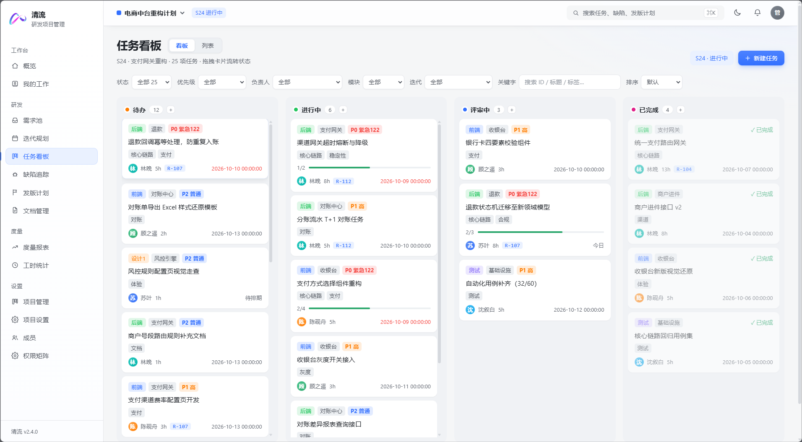

---

## 项目简介

清流 ClearFlow 是一套面向研发团队的项目管理平台，把**需求池 → 迭代规划 → 任务看板 → 缺陷追踪 → 发版计划 → 文档沉淀**串成一条可追溯的交付链，并用真实业务数据生成燃尽、流速、周期与 DORA 度量。内置 **AI 需求拆解**（只出草稿，人工确认后落库）与**全站暗色主题**（跟随系统 / 一键切换）。

工作流不是硬编码：任务 / 缺陷 / 需求 / 发版 / 迭代五类对象的状态名称、颜色与顺序都由项目自行配置，顺序即单向流转顺序；权限按「项目 × 模块」四档授权，由服务端强制校验；看板支持拖拽流转与列内排序，前端图表全部自研，零图表库依赖。

前端 **Vue 3 + Vite + Pinia**，后端 **Java 21 + Spring Boot + MyBatis-Plus + Spring Security/JWT**，数据存储 **MySQL 8**，附件走 **RustFS / S3 兼容对象存储**。

---

## 为什么是清流

多数项目管理工具要么是"给 PM 看的表格"，要么是"改不动的固定流程"。清流的做法是：**流程由项目自己定义，权限由服务端强制裁决，数据由后端统一口径计算**。

- **工作流是配置，不是代码**——任务 / 缺陷 / 需求 / 发版 / 迭代 五类对象的状态档位，每个项目都能自定义名称、颜色与顺序；顺序即单向流转顺序，最后一档为终态。改流程不需要发版。
- **权限不是前端隐藏**——`无 / 查看 / 编辑 / 管理` 四档按「项目 × 模块」授权，同一人在 A 项目可编辑、在 B 项目只读。菜单和按钮的显隐、服务端的每一次写校验，用的是同一份有效等级。
- **统计不是拍脑袋**——燃尽、流速、周期指标、DORA 全部从业务数据与 `activity` 审计日志反解得到，动态由后端在覆盖旧值**之前**比对生成，不信任前端传入的文案。
- **看板是真的能拖**——跨列拖动即状态流转（保留「状态 X → Y」动态与指派通知），列内拖动即排序；被服务端拒绝的非法流转会自动回到真实顺序。

---

## 功能地图

侧边栏四组导航，覆盖从构想到上线的完整链路：

| 分组 | 页面 | 一句话 |
| --- | --- | --- |
| 工作台 | 研发概览 · 我的工作 | 迭代进度、团队负载、风险与阻塞、今日聚焦 |
| 研发 | 需求池 · 迭代规划 · 任务看板 · 缺陷追踪 · 发版计划 · 文档管理 | 需求→排期→执行→验证→发布→沉淀 |
| 度量 | 燃尽与流速 · 工时统计 | 交付节奏、效率与投入分析 |
| 设置 | 项目管理 · 项目设置 · 成员 · 权限矩阵 | 工作流、状态/选项字典、业务模块与逐模块授权（通知偏好位于头像菜单） |

---

## 核心能力

### 研发概览：一屏看清迭代健康度

KPI 卡（需求吞吐周环比、迭代完成度、P0/P1 存量、按时交付率）、当前迭代分段进度与里程碑、团队负载、风险与阻塞、最近动态。**风险不是手工登记的**，由逾期任务、高优未关闭缺陷、超载成员三类真实数据推导；动态条目可直达对应任务/缺陷/需求详情。

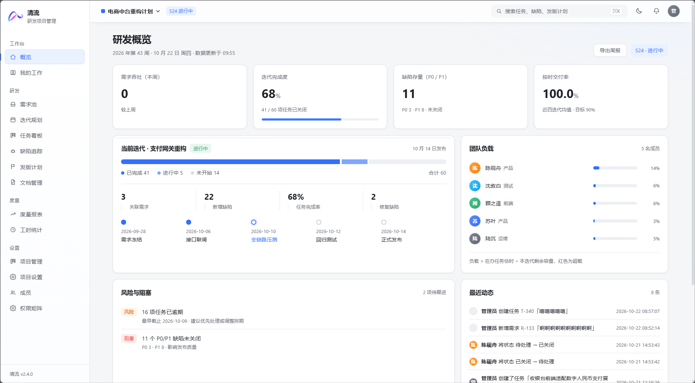

### 需求池：从收集到排期

状态（带各档计数）· 优先级 · 负责人 · 迭代 四个下拉筛选，跨页多选可批量改状态/负责人/删除，支持导出 `requirements.csv`。需求详情内置**验收标准清单**与**追踪链**——一个需求往下关联了哪些任务、引出哪些缺陷，点击即跳转，需求 ↔ 迭代 ↔ 版本是一条可追溯的链。

**AI 辅助拆解任务**：需求详情可按描述与验收标准生成任务草稿（OpenAI 兼容 `/chat/completions`）。草稿可逐条修改标题、描述、类型、优先级、估时与负责人，勾选后批量创建——AI 只产出建议，落库仍走 `POST /tasks` 的权限、动态与通知链路。未配置 Key 时自动使用本地规则模拟，并在弹窗明确标注「演示数据」，不会静默伪装成真实模型。

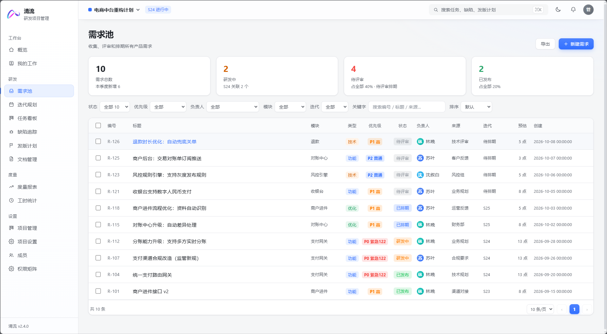

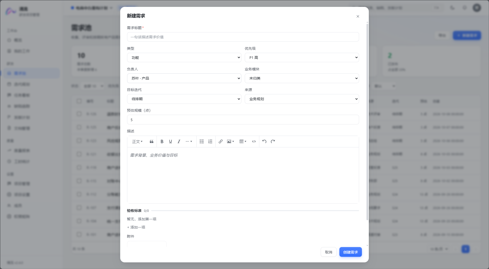

### 迭代规划：容量、燃尽、甘特

迭代详情同时给出**容量规划**（成员负载卡 + 团队近 4 周负载趋势）、**燃尽图**与**甘特时间线**（鼠标拖拽即改期，里程碑同步平移）。规划需求时按点数汇总（"已选 N 个 · 共 M 点"），结束后可做**三维五项复盘**（交付节奏 / 团队协作 / 交付质量 + 改进项清单）。

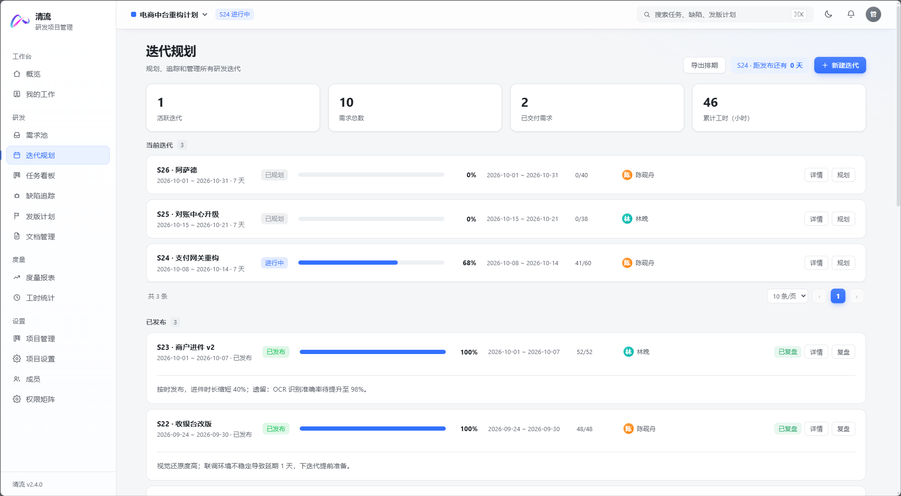

### 任务看板：拖拽流转 + 列内排序

列即工作流状态。卡片信息密度克制而完整：类型、优先级、标签、子任务进度、负责人头像、估时点、关联需求、前置任务、临期高亮。看板 / 列表双视图，详情弹窗含富文本描述（支持 @提及与图片上传）、前置任务、子任务清单、附件、评论、活动时间线与关注。

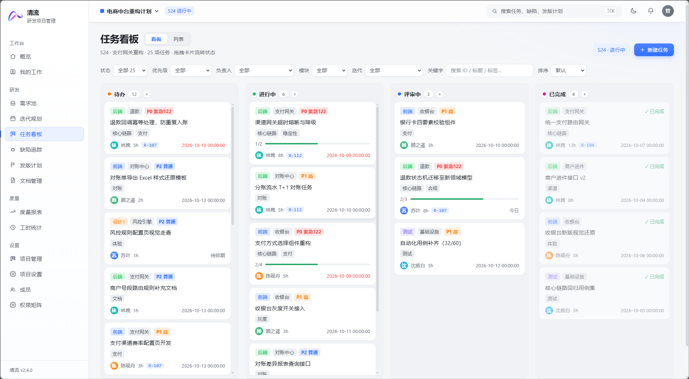

### 缺陷追踪：验证才算关闭

看板默认视图，同样支持拖拽流转与列内排序。筛选覆盖状态 / 优先级 / 当前处理人 / 迭代，近 14 天新增·关闭·存量趋势图独立成卡。缺陷详情有普通工单没有的三样东西：**复现步骤**、**缺陷间关联**（重复 / 阻塞 / 回归）、**回归验证记录**——未通过验证记录，状态推不到「已验证」。
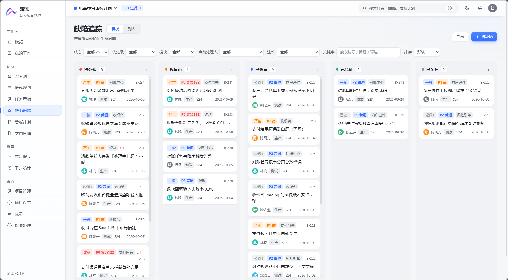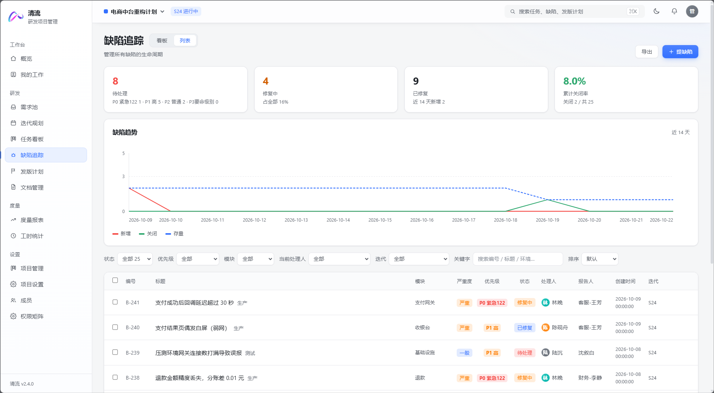

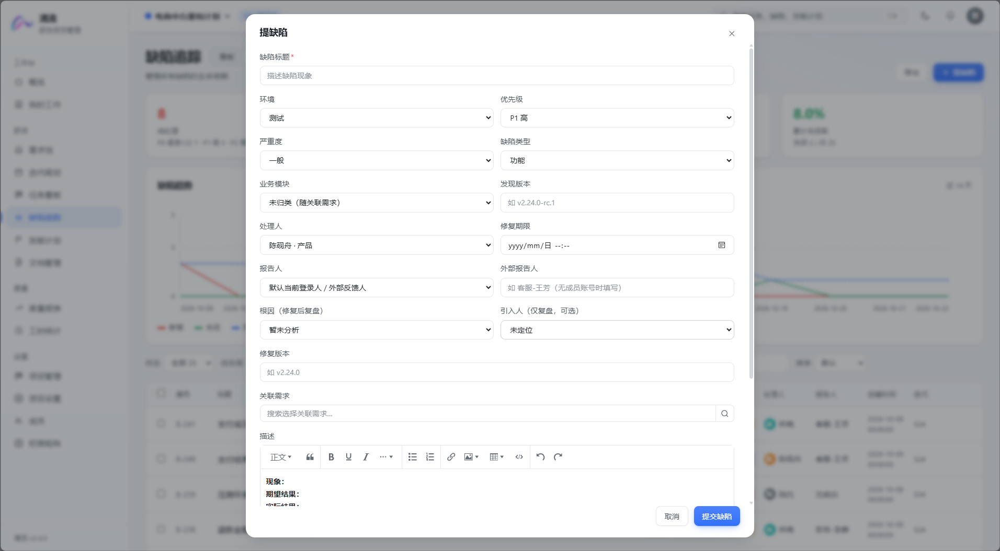

### 发版计划：关联内容，一键生成通知

版本关联需求与缺陷后，发版说明可**从关联内容自动生成草稿**（自动分为「新增功能 / 问题修复 / 注意事项」三段），再一键生成发版通知邮件（收件人自动汇总为关联需求与缺陷负责人的邮箱）。

> 清流只生成邮件内容供复制，**不会自动发送**——发布沟通仍由人来把关。

除正常流转外单独提供**回滚**旁路，状态、发布渠道（生产/灰度/内测）与风险等级全程可查。

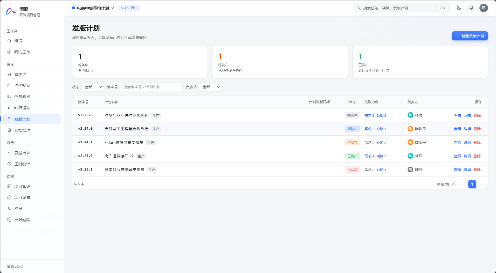
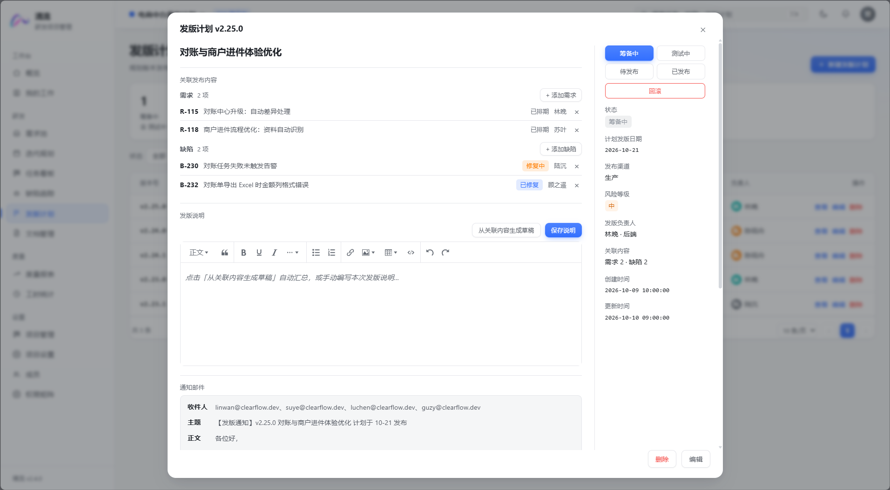
### 文档管理：Markdown 沉淀

Vditor 所见即所得编辑，阅读态自动生成右侧目录并支持平滑跳转；分类是可管理的字典，重命名会合并文档，分类下仍有文档时拒绝删除。列表 / 阅读 / 编辑三态同页切换，可按分类、更新人与关键字（同时匹配标题与正文）筛选。

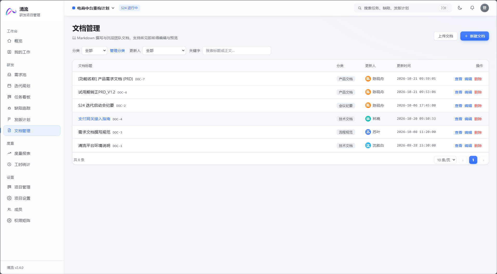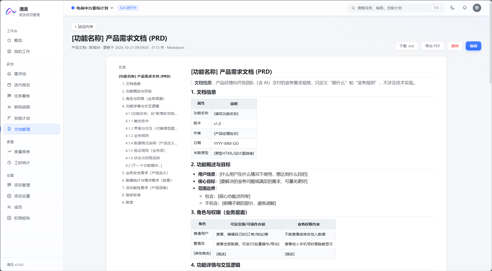
### 度量：燃尽、流速与 DORA

- **燃尽图**统一以需求点数为口径，理想线 / 实际线 / 今日 / 预测线四条图例，并按真实速率给出可读懂的结论："按当前速率 X 点/天，预计 D 清零（比迭代末尾提前 N 天）"或"迭代末尾仍将剩余 N 点，需延期或砍范围"。
- **流速图**对比承诺与交付，**吞吐折线**看每周完成任务数，两者都可点击下钻到对应迭代的看板。
- **周期指标 + DORA 四指标**（部署频率、变更前置时间、变更失败率、故障恢复时间）随报表输出，可导出 CSV。

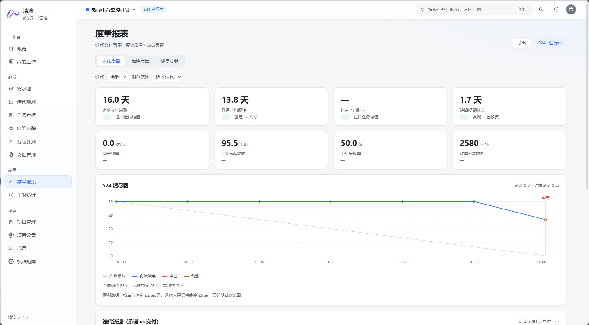
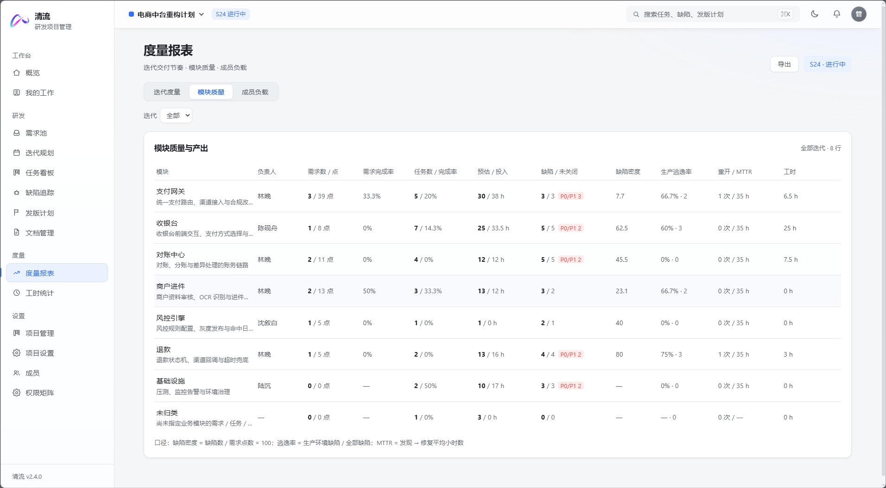
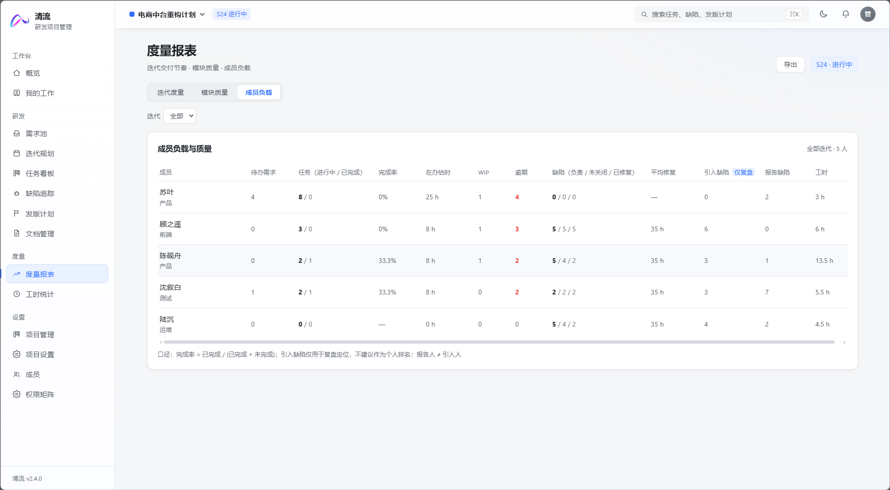
### 工时与负载

登记工时只能记本人（后端强制），单次 0.1~24 小时校验。成员负载热力日历、负载对比条形图（按个人容量阈值画红线，超出标红）、工时类型分布、预估偏差（实际 vs 估算）与明细表，同样支持 CSV 导出。

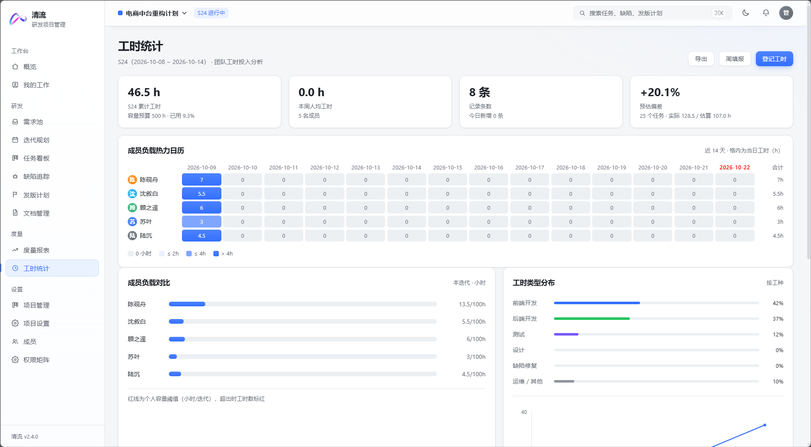

### 协作底座

评论 @提及（被提及者收站内通知）、多态附件（拖拽或 Ctrl+V 粘贴截图，私有桶 + 预签名读）、关注/取关、实体活动时间线、全局动态流、站内通知中心（未读角标 99+ 截断，乐观更新失败自动回滚）、`Ctrl/⌘ + K` 全局搜索跨任务/需求/缺陷/发版/迭代。通知设置按事件开关、仅对本人生效，切换即保存，失败自动回滚。


### 暗色主题：整站一致，不是换皮

全站颜色收敛为一套语义化 CSS 变量，`[data-theme='dark']` 只覆盖令牌层。默认跟随系统 `prefers-color-scheme`，顶栏可手动切换并记住选择；首屏在样式加载前写入主题，避免暗色用户刷新闪白。看板卡片、图表、富文本与 Markdown 预览/编辑器（含代码高亮）都会随主题切换即时重渲染。

### 项目设置：流程、字典与模块

工作流按任务 / 缺陷 / 需求 / 发版计划 / 迭代五套分别配置，顶部子标签切换，一次只编辑一套，避免长页面里多个保存按钮互相干扰。状态可增删、换色、上下移动，顺序即单向流转顺序，末档为终态。选项配置维护优先级、严重度、任务类型、标签与环境；业务模块是需求 / 任务 / 缺陷共用的归类字典，支撑模块维度的点数、缺陷密度、逃逸率与 MTTR 统计。所有配置仅当前项目生效。

### 权限矩阵：一张表看清谁能干什么

行是成员、列是模块，单元格是四档等级下拉并按等级着色。有效等级由后端统一下发，前端不重算规则，避免两套口径漂移。**项目负责人默认对本项目全权，其授权行只有系统管理员能调整**——防止负责人互相提权或自我提权。

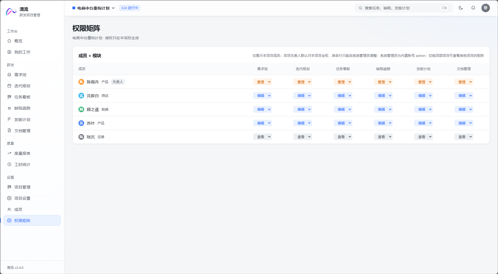

---

## 技术栈

| 层 | 选型 |
| --- | --- |
| 前端 | Vue 3 `<script setup>` + Vite · Pinia · Vue Router · wangEditor 5（富文本）· Vditor（Markdown） |
| 后端 | Java 21 · Spring Boot 4.1.1 · MyBatis-Plus 3.5.17 · Spring Security + JWT（jjwt 0.12.6）· AOP 权限切面 |
| 数据 | MySQL 8（30 张表，脚本幂等可重复执行）· 原生 JSON 列 · RustFS / S3 兼容对象存储 |
| 图表 | 纯自研 SVG / CSS（燃尽、流速、吞吐、趋势、热力、甘特），**零图表库** |
| AI | OpenAI 兼容 `/chat/completions`（`CLEARFLOW_AI_*` 环境变量配置）；未配置 Key 时本地规则 mock |
| 主题 | 语义化 CSS 变量 + `[data-theme]` 明暗双主题，跟随系统 / 手动切换，无 UI 框架依赖 |

几个值得一说的工程取舍：

- **契约优先**：接口按页面所需字段形状返回，新增字段不破坏既有调用方；列表筛选、排序与统计全部在服务端完成，只取当前页。
- **版本号单一来源**：界面版本由 `clearflow-web/package.json` 经 Vite 注入，侧边栏与概览页脚同源展示，发版只改这一处。
- **AI 降级不静默**：未配置 Key 时走本地规则模拟，接口返回 `mock` 标记、前端在弹窗明确标注「演示数据」；启动日志输出当前模式与 endpoint/model（不含 Key）。
- **响应不套信封**：成功直接返回业务数据本体，失败只用 HTTP 状态码 + `{message}`；分页统一 `{list, total, page, pageSize}`。
- **业务编号即主键**：`T-316` / `R-107` / `B-241` / `REL-006` / `S24` 由 `sequence` 表行锁发号，展示码与主键合一。
- **跨项目返回 404 而非 403**：避免泄露"这个 id 是否存在"。
- **单一快照口径**：实时操作与每日定时任务共用同一个快照函数写 `iteration_snapshot`，避免同一张表混入两套点数算法。

---

## 快速开始

### 环境

JDK 21 · Maven · MySQL 8 · Node.js 20+（RustFS / 任意 S3 兼容存储仅影响附件上传，不影响启动）

### 1. 初始化数据库

建表脚本**不会随应用自动执行**，请手工执行（两个脚本均幂等，可重复跑）：

```bash
mysql -u <user> -p < clearflow-server/src/main/resources/db/schema.sql
mysql -u <user> -p < clearflow-server/src/main/resources/db/data.sql
```

已有旧库按日期顺序补跑增量脚本 `db/upgrade-YYYY-MM-DD-<主题>.sql`。

### 2. 启动后端

```bash
cd clearflow-server
mvn spring-boot:run          # http://localhost:8080/api
```

AI 需求拆解默认可用；不配置 Key 时走本地演示数据。要调用真实模型，启动前设置环境变量（兼容 OpenAI 接口）：

```bash
export CLEARFLOW_AI_KEY=sk-...
export CLEARFLOW_AI_BASE_URL=https://api.openai.com/v1   # 可选
export CLEARFLOW_AI_MODEL=gpt-4o-mini                    # 可选
```

首次启动会为种子成员写入默认口令的 BCrypt 哈希（幂等，只处理未设置密码的行），因此顺序是 **schema → data → 启动一次 → 才能登录**。

### 3. 启动前端

```bash
cd clearflow-web
npm install
npm run dev                  # http://localhost:5173
```

`vite.config.js` 已把 `/api` 代理到 `http://localhost:8080`；后端 CORS 默认只放行 `http://localhost:5173`。

### 4. 登录

演示账号 `admin / 123456`（内置系统管理员）。

> ⚠️ 生产部署前必须替换：数据源账号口令、`clearflow.jwt.secret`、RustFS endpoint / AccessKey / SecretKey / bucket、`clearflow.admin-login`、CORS 允许源，并按需调大 `spring.servlet.multipart.*` 让附件上限真正生效、关闭 SQL 标准输出日志。

---

## 目录结构

```
clearflow-server/                 Spring Boot 服务端
  src/main/java/dev/clearflow/
    auth member project           认证、成员池、项目与项目成员
    requirement task defect       需求 / 任务 / 缺陷（状态机 + 动态 + 通知）
    iteration release doc         迭代（容量/燃尽/复盘）、发版、文档
    ai                            AI 需求拆解（只产草稿，人工确认后落库）
    stats worklog                 概览 / 度量 / 工时聚合
    collab notify bulk search     评论·附件·关注·动态、通知中心、批量、全局搜索
    settings perm file            项目级/成员级配置、权限裁决、对象存储
    module                        业务模块字典（模块维度统计口径）
    common security config infra  注解与切面、JWT、数据源、上下文与发号
  src/main/resources/db/          schema.sql · data.sql · upgrade-*.sql
clearflow-web/                    Vue 3 前端
  src/views/     16 个页面（含登录与通知设置）
  src/components/21 个共享组件（富文本/Markdown 编辑器、预览、清单、评论、上传、时间线、分页器、倒计时…）
  src/stores/    auth · perm · projects · members · iterations · options · ui
  src/styles/    global.css 设计令牌与共用样式（含暗色主题）
  src/utils/     主题（切换/持久化）、版本号、清洗、图表尺寸等
  public/vditor/ Vditor 运行时资源（本地化，不依赖外网 CDN）
```


---

<div align="center">

**清流 ClearFlow** · 让研发协作更高效

© 2026 清流 ClearFlow · 研发项目管理

</div>
